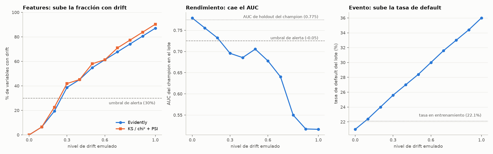

# Plan de actividad 3

Referencia: [`../../actividades/docs/actividad-3.md`](../../actividades/docs/actividad-3.md) (guía del profesor).

## Qué pide la actividad

1. Reutilizar el propio pipeline de entrenamiento/inferencia/API (actividad 2).
2. **Drift emulado en la inferencia:** el lote que puntúa sale de la parte de prueba del dataset, con un nivel de drift (0.0 a 1.0) fijo en config, no elegido por quien ejecuta la pipeline. Guardar una copia del lote para los pipelines de drift.
3. **Dos pipelines de drift:** features (Evidently, reporte por lote) y evento/target (compara la tasa de la variable objetivo, rechaza lotes sin etiquetas).
4. **Alerta** si la fracción de variables con drift supera un umbral configurable.
5. **Tests** de datos, modelo, inferencia, API y lógica de drift, sin necesitar MLflow/Prefect levantados. CI opcional.

Temas del módulo que cubre: data drift, target drift, **seguimiento del rendimiento en producción**, herramientas de monitoreo (Evidently), CI/CD y tests automatizados.

## Cómo se traduce a nuestro caso de uso

| Pieza del enunciado | En nuestro proyecto |
|---|---|
| Pipeline propio de entrenamiento/inferencia/API | Copiado y adaptado de `actividad-2/` (mismo caso de uso: default de tarjeta de crédito) |
| Drift de features | `domain/monitoreo.py::aplicar_drift` sobre `NUMERICAS_CRUDAS` (las 20 columnas originales del CSV, antes de la ingeniería de variables) |
| Drift de evento | La variable objetivo es `default.payment.next.month`; se sube su tasa en el lote en proporción al nivel de drift |
| Lote que puntúa | Muestra de la partición de **prueba** (`domain.monitoreo.dividir`, mismo `test_size`/`random_state` que usa el entrenamiento) -- nunca del entrenamiento, para que la comparación de drift sea justa |

Más allá del mínimo del enunciado (el equipo pidió desarrollar la actividad con más profundidad):

| Extra | Por qué |
|---|---|
| Pruebas estadísticas propias por variable (KS, chi-cuadrado, PSI) | Evidently da un porcentaje; estas dan **cuáles** variables cambiaron y **cuánto**, y un contraste independiente de la alerta |
| Pipeline de **rendimiento** (`rendimiento_flow.py`) | Es el tercer tema del módulo ("seguimiento del rendimiento en producción"): drift de datos y de evento dicen que algo cambió; el AUC dice si el modelo dejó de servir |
| Validación de calidad de datos (`validar_calidad`) | La rúbrica pide tests de datos (esquema, rangos, nulos); además un CSV corrupto debe fallar al cargar, no dar métricas raras después |
| Refactor a funciones puras (`construir_lote_con_drift`, `puntuar_lote`) | La rúbrica pide tests de la inferencia sin servicios; mientras la lógica viviera dentro de tareas de Prefect no se podía probar |
| Barrido de niveles 0.0 a 1.0 (`scripts/barrido_drift.py`) | Responde "¿cuánto drift hace falta para que el monitoreo lo note?" con datos, no con la intuición |

## Decisión: dónde se aplica el drift respecto a la ingeniería de variables

El drift se aplica **antes** de `agregar_variables_derivadas` (domain/ingenieria.py), sobre las columnas crudas. Así, las 8 variables derivadas (que se calculan a partir de las crudas) quedan afectadas como consecuencia natural del drift, en vez de desplazarlas por separado como si fueran independientes -- es lo que pasaría con datos reales, donde nadie "inyecta" drift directamente en una variable derivada. Está cubierto por `tests/test_inferencia.py::test_con_drift_cambian_las_columnas_derivadas_tambien`.

El lote que se guarda para los pipelines de monitoreo (`monitoreo.lote_actual`) es el lote **ya con drift y con las variables derivadas calculadas** -- el mismo que usa `predecir()` para puntuar. Así los tres pipelines comparan exactamente lo que vio el modelo, no una versión distinta.

## Decisión: significancia estadística **y** magnitud

Con un lote de 500 filas contra ~24,000 de referencia, un test como el KS puede dar un p-valor chiquito para un cambio que no le importa a nadie. Por eso una variable se marca con drift solo si el test es significativo (`p < alfa_variable`) **y** el cambio es de magnitud relevante (`PSI >= umbral_psi`, 0.10: el límite entre "estable" y "cambio moderado" en la práctica de riesgo de crédito). Probado en `tests/test_pruebas_drift.py::test_efecto_diminuto_no_cuenta_como_drift_aunque_sea_significativo`.

- **Continuas:** Kolmogorov-Smirnov de dos muestras (compara la distribución completa, no solo la media).
- **Discretas** (`SEX`, `EDUCATION`, `MARRIAGE`, `PAY_*`, `meses_con_atraso`): chi-cuadrado sobre la tabla de frecuencias. Las categorías con menos de 5 observaciones esperadas se agrupan en "otras" (regla clásica de validez del chi-cuadrado), porque categorías rarísimas como `PAY_0 = 8` romperían el test.
- **PSI** con intervalos por cuantiles de la referencia. Limitación conocida: no tiene tope; con cambios extremos los intervalos quedan vacíos y el valor lo domina el piso `EPSILON=1e-4` (por eso salen valores ~16). Sirve para **ordenar** variables y compararlo contra 0.10 / 0.25, no como número absoluto.

## Problema real encontrado: tamaño de lote y ruido de muestreo

Con `inferencia.tamano_lote: 100` (el mismo valor que traía actividad-2 para su lote simulado), el pipeline de drift de features marcaba **45% de las variables con drift incluso con `nivel_drift: 0.0`** (sin drift real) -- habría generado una alerta falsa en cada corrida normal.

Causa: comparar un lote de solo 100 filas contra ~24,000 filas de entrenamiento hace que la distancia entre distribuciones (Wasserstein/Jensen-Shannon, que usa Evidently por columna) salga alta solo por el tamaño de muestra, sobre todo en columnas con cola larga (`BILL_AMT*`, `PAY_AMT*`, que tienen outliers de montos grandes). Se probó con [`scripts/explorar_tamano_lote.py`](./scripts/explorar_tamano_lote.py):

| `tamano_lote` | % variables marcadas con drift (nivel_drift=0.0, debería ser ~0%) |
|---|---|
| 100 | 45.16% |
| 300 | 6.45% |
| 500 | 0.00% |
| 800 | 0.00% |
| 1200 | 0.00% |

Se fijó `inferencia.tamano_lote: 500` en `configs/config.yaml`. Las pruebas estadísticas propias dan 0% con 500 filas, así que el problema no era de Evidently: era del tamaño de muestra.

## Resultados: verificación en vivo del criterio de éxito

Corridas reales contra el champion vigente (`credit-default-modelo`, versión 2, el mismo registrado en actividad 2), con `tamano_lote=500`:

| `nivel_drift` | % features con drift (Evidently) | Alerta de features | Tasa de default del lote | p-valor (chi-cuadrado) | Alerta de evento | AUC del lote (holdout: 0.775) | Alerta de rendimiento |
|---|---|---|---|---|---|---|---|
| 0.0 | 0% | No | 21.0% (entrenamiento: 22.1%) | 0.5869 | No | 0.779 | No |
| 0.6 | 61% | **Sí** | 30.0% | 0.0000 | **Sí** | 0.678 | **Sí** |

Los dos reportes HTML son distintos entre sí -- confirma el criterio de éxito ("las ejecuciones con nivel 0.0 y 0.6 producen reportes de drift distintos"). Conservados como evidencia en [`docs/evidencia/`](./docs/evidencia/) (`reports/` se regenera en cada corrida y no se versiona). Con nivel 0.6 el log explica la alerta: las variables que más cambiaron son `PAY_6`, `PAY_4`, `PAY_2`, `meses_con_atraso` e `interaccion_atraso_x_limite` (estas dos últimas, derivadas: reflejan el drift de las crudas sin haberlas tocado).

### Barrido de niveles 0.0 a 1.0

Generado por [`scripts/barrido_drift.py`](./scripts/barrido_drift.py) contra el champion real; tabla completa en [`docs/graficos/barrido_drift.csv`](./docs/graficos/barrido_drift.csv):

| Nivel | Features con drift (Evidently / pruebas propias) | Tasa de default | p-valor evento | AUC del lote | Recall del lote |
|---|---|---|---|---|---|
| 0.0 | 0% / 0% | 21.0% | 0.587 | 0.779 | 0.648 |
| 0.1 | 6% / 6% | 22.4% | 0.925 | 0.756 | 0.598 |
| 0.2 | 19% / 23% | 24.0% | 0.344 | 0.732 | 0.592 |
| **0.3** | **39% / 42%** | 25.6% | 0.072 | **0.696** | 0.797 |
| **0.4** | 45% / 45% | 27.0% | **0.011** | 0.686 | 0.593 |
| 0.5 | 55% / 58% | 28.4% | 0.001 | 0.706 | 0.535 |
| 0.6 | 61% / 61% | 30.0% | 0.00004 | 0.678 | 0.600 |
| 0.7 | 68% / 71% | 31.6% | 6e-7 | 0.640 | 0.753 |
| 0.8 | 74% / 77% | 33.0% | 1e-8 | 0.550 | 0.909 |
| 0.9 | 81% / 84% | 34.4% | 1e-10 | 0.517 | 0.884 |
| 1.0 | 87% / 90% | 36.0% | 3e-13 | 0.516 | 0.906 |

Primer nivel que dispara cada alerta: **features y rendimiento: 0.3; evento: 0.4.**

Lo que muestra:

1. **Los dos métodos de features coinciden.** Evidently (Wasserstein / Jensen-Shannon) y las pruebas propias (KS / chi-cuadrado + PSI) difieren como máximo 3.2 puntos porcentuales en los 11 niveles, y dan el mismo veredicto de alerta en todos. Son técnicas distintas: que coincidan le da confianza a la alerta.
2. **El drift de evento es el más lento en detectarse.** Con 500 filas el error estándar de la tasa de default es ~1.9 puntos, así que un cambio de +3.5 puntos (nivel 0.3) todavía no alcanza significancia (p=0.07); hace falta +4.9 (nivel 0.4). Las features, en cambio, delatan el problema antes de que el target se mueva.
3. **El recall solo habría ocultado la degradación.** A nivel 1.0 el AUC es 0.516 (el modelo ya no distingue nada), pero el recall del lote es **0.906**: con los atrasos desplazados el modelo marca a casi todos como riesgo y "atrapa" casi todos los defaults. Es exactamente el caso por el que en actividad 2 se exigió AUC *y* recall para promover un champion, ahora visto del lado de producción.
4. **El AUC del lote es ruidoso** (cae de 0.686 a 0.706 entre los niveles 0.4 y 0.5): con 500 filas varía ~±0.03 por muestreo, y cada nivel desplaza un número distinto de columnas. Por eso `tolerancia_auc` es 0.05 y no 0.01.

Limitación de la emulación: el drift del target sube la tasa de default convirtiendo 0 en 1 **al azar**, sin relación con las features. Es ruido de etiqueta puro, que degrada el AUC más de lo que lo haría un cambio de concepto real (donde el modelo seguiría capturando parte de la señal). Sirve para disparar y comparar las alertas, no para estimar cuánto rendimiento se perdería en producción.

## Experimento T3: falsas alarmas y capacidad de detección

### Objetivo

Evaluar el comportamiento del pipeline de monitoreo de features mediante simulaciones repetidas, cuantificando tanto la tasa de falsas alarmas cuando no se introduce drift como la capacidad de detección cuando se emula un nivel de drift de 0.3.

Diseño experimental

Se realizaron 100 simulaciones distribuidas en dos escenarios:

Drift 0.0: 50 simulaciones para evaluar las falsas alarmas.

Drift 0.3: 50 simulaciones para evaluar la capacidad de detección.

En cada escenario se utilizaron semillas de 0 a 49, variando las particiones y muestras de datos mediante la configuración de aleatoriedad. La referencia corresponde a los datos de entrenamiento y el lote de monitoreo se obtiene de la partición de prueba. Se conserva el mismo mecanismo de emulación de drift y la recalculación de las variables derivadas.

La alerta de features se determina mediante el criterio oficial del pipeline:

fraccion_evidently > cfg["monitoreo"]["umbral_drift"]

Con un umbral configurado en 0.30, la alerta se activa cuando la proporción de variables detectadas con drift por Evidently supera el 30%.

Resultados

| Nivel de drift | Simulaciones | Alertas | Drift promedio detectado | Mediana | Tasa de alertas |
|---|---:|---:|---:|---:|---:|
| 0.0 | 50 | 0 | 3.10% | 0.00% | 0.00% |
| 0.3 | 50 | 47 | 39.74% | 38.71% | 94.00% |

Análisis de resultados

Escenario sin drift (0.0). En las 50 simulaciones no se generaron alertas. La fracción promedio de variables detectadas con drift fue del 3.10%, lo que indica que el monitoreo presentó un comportamiento estable bajo las condiciones evaluadas.

Escenario con drift (0.3). Se generaron alertas en 47 de las 50 simulaciones, alcanzando una tasa de detección observada del 94%. La proporción promedio de variables identificadas con drift fue del 39.74%, superando el umbral configurado del 30%.

Las tres simulaciones en las que no se generó alerta fueron:

Semilla

Fracción de variables con drift

13

29.03%

31

25.81%

45

25.81%

En estos casos, la proporción de variables detectadas no superó el umbral establecido, por lo que el sistema no activó la alerta. Este comportamiento es consistente con la regla de decisión implementada.

Conclusión

Los resultados muestran un comportamiento favorable del sistema de monitoreo en las condiciones experimentales evaluadas: no se observaron falsas alarmas en las 50 simulaciones con drift 0.0 y se obtuvo una tasa de detección del 94% en las 50 simulaciones con drift 0.3.

Sin embargo, estos resultados no implican que la probabilidad real de falsas alarmas sea cero ni que la detección sea universal. Las simulaciones utilizan diferentes particiones y muestras provenientes del mismo dataset, por lo que evalúan la estabilidad del mecanismo bajo variaciones de muestreo, pero no su comportamiento frente a múltiples datasets independientes o escenarios reales de producción.

Artefactos generados

scripts/falsas_alarmas.py: ejecución del experimento.

docs/graficos/resultados_falsas_alarmas.csv: resultados individuales de las simulaciones.

docs/graficos/resumen_falsas_alarmas.csv: resumen estadístico por escenario.

## Tests (99, sin MLflow ni Prefect)

| Qué pide la rúbrica | Dónde | Qué cubre |
|---|---|---|
| Datos: esquema, rangos, nulos | `tests/test_datos.py` | Columna faltante, nulos, rangos (`LIMIT_BAL`, `AGE`, `PAY_*`, `PAY_AMT*`), categorías no permitidas, objetivo no binario, rechazo al cargar un CSV corrupto |
| Modelo | `tests/test_modelo.py` | Heredado de actividad 2: factory de candidatos, k-fold, regla de champion |
| Inferencia | `tests/test_inferencia.py` | El lote viene solo de prueba (sin solapar con entrenamiento), es reproducible, incluye las derivadas, el drift las afecta; `puntuar_lote` respeta el umbral, no muta el lote, ignora columnas ajenas |
| API | `tests/test_api.py` | `/predict` con modelo de juguete, rechazo de clientes incompletos (422) |
| Drift | `tests/test_monitoreo.py`, `tests/test_pruebas_drift.py` | Emulación, drift de evento, rechazo de lotes sin etiquetas, rendimiento, PSI/KS/chi-cuadrado, y una prueba de integración: sin drift casi nada se marca, con drift se supera el umbral, y más drift marca más variables |

Verificado también en GitHub: el CI (`../.github/workflows/ci.yml`) corrió sobre el PR #9 y pasó.

## Decisiones técnicas adicionales

| Decisión | Alternativas consideradas | Por qué se eligió |
|---|---|---|
| Reutilizar el mismo `nombre_modelo`/experimento de MLflow que actividad-2 (`credit-default-modelo`) | Un modelo/experimento separado para actividad-3 | Es el mismo sistema en producción, ahora con monitoreo encima -- no un proyecto nuevo. El champion de actividad-2 sigue siendo el que se vigila |
| `SUBIDA_TASA_MAXIMA = 0.15` (nivel=1.0 sube la tasa de default hasta 15 puntos) | Un valor más agresivo (ej. 0.3, como en el ejemplo de referencia del profesor) | La tasa real de default es ~22%; +30 puntos la llevaría a más de 50%, un escenario poco realista para una emulación. +15 puntos en el extremo ya genera un drift claro (ver barrido) |
| Drift sobre columnas crudas, no sobre las 8 derivadas | Aplicar drift también directamente a las derivadas | Las derivadas se calculan a partir de las crudas; desplazarlas por separado sería inconsistente (ej. `utilizacion_promedio` quedaría desincronizada de `BILL_AMT*` y `LIMIT_BAL`) |
| El lote de monitoreo es el mismo que puntúa la inferencia (un solo archivo `lote_actual.csv`) | Que cada pipeline de drift tome su propia muestra | Evita que los pipelines comparen lotes distintos entre sí o distintos al que de verdad puntuó la API -- la trazabilidad es más simple con una sola fuente |
| La alerta de features sale de Evidently; las pruebas propias son contraste | Alertar con las pruebas propias, o con "cualquiera de las dos" | El enunciado pide Evidently para este pipeline. Las pruebas propias explican la alerta y avisan si discrepan, sin cambiar el contrato del pipeline |
| El pipeline de rendimiento compara contra `auc_holdout` del run de entrenamiento del champion | Compararlo contra el AUC de k-fold (el que decide el champion) | El lote sale de la misma partición de prueba que el holdout, así que es la referencia comparable; el k-fold se calculó solo sobre entrenamiento |

## Pendiente

- Memoria 3 (y después la actividad 4, documento de reflexión de 2 páginas).
- Tareas de código para el equipo: [`PARA_COMPANEROS.md`](./PARA_COMPANEROS.md).
