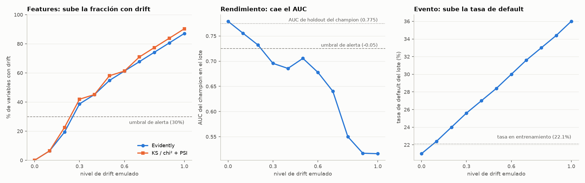

# Actividad 3: Monitoreo, drift y CI

**Caso de uso:** el mismo de actividades 1 y 2 — predicción de incumplimiento de pago (default) de clientes de tarjeta de crédito. Copia propia del dataset en `data/credit_card_default.csv` (no versionado en git, igual que en las actividades anteriores).

## Qué agrega esta actividad sobre la 2

Reutiliza el pipeline de entrenamiento/inferencia/API y la ingeniería de variables de `actividad-2/` (copiados y adaptados, no importados — cada actividad es autocontenida) y lo convierte de "entrenado una vez" a "vigilado en el tiempo", con **tres señales de monitoreo** independientes:

| Señal | Pregunta que responde | Pipeline | Cómo lo mide |
|---|---|---|---|
| Drift de **features** | ¿cambiaron los datos de entrada? | `drift_features_flow.py` | Evidently (alerta) + pruebas propias por variable: Kolmogorov-Smirnov (continuas), chi-cuadrado (discretas) y PSI |
| Drift de **evento** | ¿cambió la tasa de default? | `drift_evento_flow.py` | Chi-cuadrado sobre la tasa de default del lote vs. entrenamiento |
| **Rendimiento** | ¿el modelo sigue funcionando? | `rendimiento_flow.py` | AUC del champion sobre el lote vs. su AUC de holdout; queda registrado en MLflow (`fase=monitoreo`) |

Y el resto de lo que pide la actividad:

- **Drift emulado en la inferencia** (`domain/monitoreo.py`): el lote sale de la partición de **prueba** (nunca del entrenamiento) y se le aplica un drift controlado por `inferencia.nivel_drift` (0.0 a 1.0) *antes* de la ingeniería de variables, para que las columnas derivadas reflejen el drift como pasaría con datos reales.
- **Calidad de datos** (`src/datos.py::validar_calidad`): nulos, rangos y valores permitidos; un CSV corrupto falla ruidosamente al cargar.
- **Lógica sin servicios:** lo que antes vivía dentro de tareas de Prefect (armar el lote, puntuarlo, medir drift) está en funciones puras de `domain/`, así los **99 tests** corren sin MLflow ni Prefect.
- **CI** (`../.github/workflows/ci.yml`): corre `poetry run pytest` en cada PR y en cada push a `master`. Verificado en GitHub (PR #9, check `pruebas` en verde).

Ver [`PLAN.md`](./PLAN.md) para las decisiones, los problemas reales encontrados y los resultados de las corridas.

## Estructura

```
actividad-3/
├── configs/
│   ├── config.yaml        # datos, candidatos, MLflow, champion, inferencia (+ nivel_drift), monitoreo (umbrales)
│   └── features.yaml      # selección de variables (igual que actividad-2)
├── domain/                # lógica pura, sin Prefect ni MLflow
│   ├── modelo.py           # pipeline, métricas, regla de champion, puntuar_lote
│   ├── ingenieria.py        # 8 variables derivadas (igual que actividad-2)
│   ├── monitoreo.py         # NUEVO: emulación de drift, drift de evento, rendimiento
│   └── pruebas_drift.py     # NUEVO: KS / chi-cuadrado / PSI por variable
├── infraestructure/
│   ├── flows/
│   │   ├── entrenamiento_flow.py   # igual que actividad-2
│   │   ├── inferencia_flow.py      # adaptado: lote de prueba + drift emulado + guarda lote_actual
│   │   ├── drift_features_flow.py  # NUEVO
│   │   ├── drift_evento_flow.py    # NUEVO
│   │   ├── rendimiento_flow.py     # NUEVO
│   │   └── desplegar.py            # entrenamiento (manual) + inferencia (diaria)
│   └── api/main.py          # igual que actividad-2
├── scripts/
│   ├── explorar_tamano_lote.py     # por qué inferencia.tamano_lote=500
│   └── barrido_drift.py            # barrido de niveles 0.0-1.0 -> docs/graficos/
├── src/                    # config.py, datos.py (+ validar_calidad)
├── data/                   # dataset + lote_actual.csv + predicciones (gitignored)
├── reports/                # reportes de Evidently y tablas por variable (gitignored, se regenera)
├── docs/
│   ├── evidencia/           # dos reportes HTML reales conservados como prueba (nivel 0.0 y 0.6)
│   └── graficos/            # barrido de niveles de drift (gráfico + CSV)
├── tests/                  # datos, modelo, inferencia, API, drift, pruebas estadísticas
└── pyproject.toml
```

## Entorno

Requiere los servicios de MLflow y Prefect levantados (ver `../services/README.md`), un champion ya registrado por `actividad-2/` o por el entrenamiento de esta misma actividad (comparten el mismo modelo `credit-default-modelo` en MLflow), y en cada terminal:

```powershell
poetry install
$env:PREFECT_API_URL = "http://localhost:4200/api"
$env:MLFLOW_TRACKING_URI = "http://localhost:5000"
$env:PYTHONUTF8 = "1"
```

## Cómo correr el proyecto, en orden

```powershell
# 0. Tests (no necesitan servicios)
poetry run pytest -q

# 1. (si no hay champion todavía) entrena y registra
poetry run python infraestructure/flows/entrenamiento_flow.py

# 2. Puntúa un lote de prueba con drift emulado (nivel fijo en configs/config.yaml) y lo guarda
poetry run python infraestructure/flows/inferencia_flow.py

# 3. Las tres señales de monitoreo sobre ese lote
poetry run python infraestructure/flows/drift_features_flow.py
poetry run python infraestructure/flows/drift_evento_flow.py
poetry run python infraestructure/flows/rendimiento_flow.py

# 4. Despliegues en Prefect (entrenamiento manual, inferencia diaria)
poetry run python infraestructure/flows/desplegar.py

# 5. API
poetry run uvicorn infraestructure.api.main:app --reload

# Extra: barrido de niveles 0.0 a 1.0 (tabla + gráfico en docs/graficos/)
poetry run python scripts/barrido_drift.py
```

Para comparar niveles (0.0, 0.3, 0.6), cambia `inferencia.nivel_drift` en `configs/config.yaml` entre corridas de los pasos 2 y 3.

## Criterio de éxito: verificado en vivo contra el champion real (v2)

| `nivel_drift` | Features con drift | Alerta features | Tasa de default (lote) | Alerta evento | AUC del lote | Alerta rendimiento |
|---|---|---|---|---|---|---|
| 0.0 | 0% | No | 21.0% (entrenamiento: 22.1%) | No | 0.779 | No |
| 0.6 | 61% | **Sí** | 30.0% | **Sí** | 0.678 (holdout: 0.775) | **Sí** |

El barrido completo muestra además **cuánto drift hace falta para que cada señal lo note**:



Detalle, decisiones y problemas encontrados en [`PLAN.md`](./PLAN.md).

## Pendiente

Memoria 3: [`docs/memoria-3.md`](./docs/memoria-3.md) ya tiene las secciones 1-6 armadas; faltan la 7 (Conclusiones) y la 8 (Uso de IA), que escribe el equipo. Tareas de código para el equipo en [`PARA_COMPANEROS.md`](./PARA_COMPANEROS.md).
