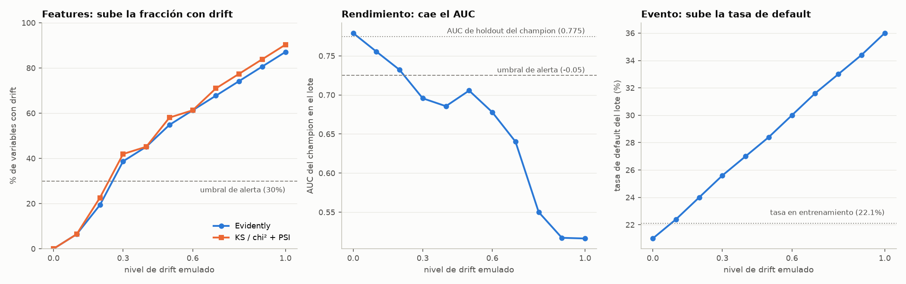

# Memoria 3: Monitoreo, drift y CI

**Integrantes del equipo:**

| Nombre completo | Usuario de GitHub |
|---|---|
| Juan Pablo Velez Hurtado | KingAegon19 |
| Jose Fernando Castrillon Alzate | josefdocas |
| Emmanuela Jimenez Prado | Emmaprado |

## 1. Objetivo

Pasar el sistema de las actividades 1 y 2 (predicción de incumplimiento de pago de clientes de
tarjeta de crédito, con un modelo `champion` en MLflow servido por una API) de "entrenado una vez"
a "vigilado en el tiempo": detectar cuándo cambian los datos, alertar cuando el drift supera un
umbral, medir si el modelo sigue funcionando y comprobar los cambios de código con tests
automatizados. Reutiliza el pipeline, el modelo y el champion de la actividad 2 y le agrega la
capa de monitoreo que le faltaba.

## 2. Descripción del trabajo

1. **Drift emulado en la inferencia (`domain/monitoreo.py`, `inferencia_flow.py`).** El lote que
   puntúa cada corrida sale de la partición de **prueba** del dataset (nunca del entrenamiento) y
   se le aplica un drift controlado por `inferencia.nivel_drift` en `configs/config.yaml` (0.0 a
   1.0): desplaza la distribución de una fracción de las variables numéricas crudas y sube la tasa
   de default. Después se recalculan las variables derivadas y se guarda una copia del lote para los
   pipelines de monitoreo.

2. **Tres pipelines de monitoreo en Prefect**, cada uno responde una pregunta distinta:
   - **Drift de features** (`drift_features_flow.py`): ¿cambiaron los datos de entrada? Compara el
     lote contra el entrenamiento con Evidently (reporte HTML por lote; de aquí sale la alerta) y
     con pruebas estadísticas propias por variable -- Kolmogorov-Smirnov (continuas),
     chi-cuadrado (discretas) y PSI (magnitud) -- que explican la alerta y sirven de contraste.
   - **Drift de evento** (`drift_evento_flow.py`): ¿cambió la tasa de default? Chi-cuadrado contra la
     del entrenamiento; rechaza con un mensaje claro los lotes sin etiquetas.
   - **Rendimiento** (`rendimiento_flow.py`): ¿el modelo sigue sirviendo? Calcula el AUC del
     champion sobre el lote (que trae las etiquetas reales) y lo compara con su AUC de holdout;
     registra un run en MLflow con tag `fase=monitoreo`.

3. **Alertas con umbral configurable.** Si la fracción de variables con drift supera
   `monitoreo.umbral_drift` (30%), si el p-valor del evento cae bajo `monitoreo.alfa_evento` (0.05)
   o si el AUC cae más de `monitoreo.tolerancia_auc` (0.05), el pipeline emite una alerta en el log.

4. **Tests (99, sin MLflow ni Prefect).** Datos (esquema, rangos, nulos, categorías permitidas),
   modelo, inferencia, API y lógica de drift. Para poder probar la inferencia sin servicios se sacó
   su lógica a funciones puras (`construir_lote_con_drift`, `puntuar_lote`) y se agregó una
   validación de calidad de datos (`src/datos.py::validar_calidad`).

5. **CI (`.github/workflows/ci.yml`).** GitHub Actions corre `poetry run pytest` en cada pull
   request y en cada push a `master`.

6. **Barrido de niveles (`scripts/barrido_drift.py`).** Mide las tres señales con niveles de drift de
   0.0 a 1.0 contra el champion real, para saber cuánto drift hace falta para que cada alerta salte.

7. **Robustez del umbral con 50 semillas (`scripts/falsas_alarmas.py`, aporte de José).** Todo lo
   anterior se midió con una sola semilla; este experimento repite el armado del lote con 50
   semillas distintas (cambiando la partición y la muestra) para estimar la tasa de falsas alarmas
   sin drift (nivel 0.0) y la tasa de detección con drift (nivel 0.3).

## 3. Decisiones técnicas

| Decisión | Alternativas consideradas | Por qué se eligió |
|---|---|---|
| Aplicar el drift a las columnas **crudas**, antes de la ingeniería de variables | Desplazar también las 8 variables derivadas directamente | Las derivadas se calculan a partir de las crudas; desplazarlas por separado las dejaría inconsistentes entre sí. Con datos reales nadie "inyecta" drift en una variable derivada |
| El lote sale de la partición de **prueba** | Tomarlo de todo el dataset (como en la actividad 2) | Si el lote compartiera filas con el entrenamiento, la comparación de drift no sería justa: la referencia ya las habría visto |
| `tamano_lote = 500` | 100 (el valor heredado de la actividad 2) | Con 100 filas el ruido de muestreo ya marcaba 45% de las variables con drift sin drift real; con 500, 0% (ver sección 6) |
| Una variable tiene drift si el test es significativo **y** el PSI supera 0.10 | Usar solo el p-valor | Con muestras grandes un p-valor diminuto puede salir de un cambio que no importa en la práctica; el PSI aporta el tamaño del efecto |
| La alerta de features sale de Evidently; las pruebas propias son contraste | Alertar con las pruebas propias o con "cualquiera de las dos" | El enunciado pide Evidently para este pipeline; las pruebas propias explican la alerta y avisan si discrepan, sin cambiar el contrato |
| Un pipeline de **rendimiento** aparte | Medir el rendimiento dentro de la inferencia | En producción las etiquetas reales llegan con retraso: medir el rendimiento es un trabajo sobre lotes ya "cerrados", no sobre la predicción del día |
| Comparar contra el AUC de **holdout** del champion | Compararlo contra el AUC de k-fold | El lote sale de la misma partición de prueba que el holdout, así que es la referencia comparable; el k-fold se calculó solo sobre entrenamiento |
| `SUBIDA_TASA_MAXIMA = 0.15` | 0.30, como en el ejemplo de referencia del curso | La tasa real de default es ~22%; +30 puntos la llevaría a más de 50%, poco realista. +15 en el extremo ya produce un drift claro |
| Lógica de drift e inferencia en funciones puras de `domain/` | Dejarla dentro de las tareas de Prefect | El enunciado pide tests sin servicios levantados; mientras viviera dentro de las tareas, no se podía probar |
| Reutilizar el mismo modelo y experimento de MLflow de la actividad 2 | Un modelo separado para la actividad 3 | Es el mismo sistema, ahora con monitoreo encima: se vigila el champion que ya existe |

## 4. Evidencias

- Repositorio: https://github.com/KingAegon19/Actividades-mlops (carpeta `actividad-3/`)
- Pull request de la actividad: https://github.com/KingAegon19/Actividades-mlops/pull/9
- Ejecución del CI en GitHub Actions (check `pruebas` en verde, 99 tests): https://github.com/KingAegon19/Actividades-mlops/actions/runs/43747585688
- Decisiones, hallazgos y tablas completas de cada corrida real: [`PLAN.md`](../PLAN.md)
- Reportes de Evidently de dos corridas reales, abribles en el navegador: [`evidencia/`](./evidencia/) -- sin drift ([`drift_features_nivel_0.0.html`](./evidencia/drift_features_nivel_0.0.html)) y con drift 0.6 ([`drift_features_nivel_0.6.html`](./evidencia/drift_features_nivel_0.6.html))
- Barrido de niveles de drift (gráfico y tabla completa): [`graficos/`](./graficos/)
- Experimento de robustez con 50 semillas (resultados por simulación y resumen): [`graficos/resultados_falsas_alarmas.csv`](./graficos/resultados_falsas_alarmas.csv) y [`graficos/resumen_falsas_alarmas.csv`](./graficos/resumen_falsas_alarmas.csv)
- Pull requests del equipo, integrados a la rama de la actividad con el CI en verde: [#10 (memoria)](https://github.com/KingAegon19/Actividades-mlops/pull/10) y [#11 (experimento de falsas alarmas)](https://github.com/KingAegon19/Actividades-mlops/pull/11)

Salida de terminal de las corridas reales contra el champion (extracto del log de Prefect, sin marcas
de tiempo): primero con `nivel_drift: 0.0`, donde no salta ninguna alerta, y luego con `nivel_drift: 0.6`.

```text
# nivel_drift = 0.0
Lote de 500 clientes tomado de prueba, con nivel de drift 0.0
500 predicciones guardadas en data\prediccion_2026-11-15.csv (probabilidad media = 0.4282)
Pruebas estadísticas: ninguna variable con drift
Sin alerta: drift de features en 0% de las variables (umbral 30%)
Pruebas estadísticas: 0% de las variables con drift -> coinciden con Evidently
Tasa de default: entrenamiento 22.1%, lote 21.0% (p-valor 0.5869)
Sin alerta: drift del target (p-valor 0.5869 >= 0.05)
AUC del lote 0.7792 vs referencia 0.7749 (caída -0.0043); recall del lote 0.6476
Sin alerta: el AUC cayó -0.0043 (tolerancia 0.05)

# nivel_drift = 0.6
Lote de 500 clientes tomado de prueba, con nivel de drift 0.6
500 predicciones guardadas en data\prediccion_2026-11-15.csv (probabilidad media = 0.5039)
Pruebas estadísticas: 19 de 31 variables con drift. Las que más cambiaron:
  - PAY_6: PSI=15.94 (importante), chi2 p=0.0000
  - PAY_4: PSI=15.89 (importante), chi2 p=0.0000
  - PAY_2: PSI=15.88 (importante), chi2 p=0.0000
  - meses_con_atraso: PSI=9.56 (importante), chi2 p=0.0000
  - interaccion_atraso_x_limite: PSI=9.55 (importante), ks p=0.0000
ALERTA: drift de features en 61% de las variables (umbral 30%)
Pruebas estadísticas: 61% de las variables con drift -> coinciden con Evidently
Tasa de default: entrenamiento 22.1%, lote 30.0% (p-valor 0.0000)
ALERTA: drift del target (p-valor 0.0000 < 0.05)
AUC del lote 0.6779 vs referencia 0.7749 (caída +0.0970); recall del lote 0.6000
ALERTA: el AUC cayó 0.0970 (tolerancia 0.05)
```

## 5. Resultados

Criterio de éxito, verificado en vivo contra el champion real (`credit-default-modelo` v2,
`random-forest-balanced`), con lotes de 500 clientes:

| `nivel_drift` | Features con drift (Evidently) | Alerta | Tasa de default del lote | Alerta | AUC del lote (holdout: 0.775) | Alerta |
|---|---|---|---|---|---|---|
| 0.0 | 0% | No | 21.0% (entrenamiento: 22.1%) | No | 0.779 | No |
| 0.6 | 61% | **Sí** | 30.0% | **Sí** | 0.678 | **Sí** |

Los reportes de las dos corridas son distintos entre sí, como pide el enunciado. Con nivel 0.6 el
log explica la alerta: las variables que más cambiaron son `PAY_6`, `PAY_4`, `PAY_2`,
`meses_con_atraso` e `interaccion_atraso_x_limite` (estas dos últimas son derivadas: reflejan el
drift de las crudas sin haberlas tocado).

Barrido de niveles de 0.0 a 1.0:



| Nivel | Features con drift (Evidently / pruebas propias) | Tasa de default | AUC del lote | Recall del lote |
|---|---|---|---|---|
| 0.0 | 0% / 0% | 21.0% | 0.779 | 0.648 |
| 0.3 | 39% / 42% | 25.6% | 0.696 | 0.797 |
| 0.6 | 61% / 61% | 30.0% | 0.678 | 0.600 |
| 1.0 | 87% / 90% | 36.0% | 0.516 | 0.906 |

Primer nivel que dispara cada alerta: **features y rendimiento, 0.3; evento, 0.4.**

Lo que muestra:

- **Dos métodos independientes coinciden.** Evidently y las pruebas propias (KS / chi-cuadrado + PSI)
  difieren como máximo 3.2 puntos porcentuales en los 11 niveles y dan el mismo veredicto de alerta
  en todos: que coincidan le da confianza a la alerta.
- **El umbral del 30% resiste el cambio de semilla.** En 50 simulaciones con nivel 0.0 no hubo
  ninguna falsa alarma (en promedio solo el 3.1% de las variables se marcó con drift), y con nivel 0.3
  se detectó el drift en 47 de 50 (94%). Las tres que no alertaron quedaron cerca, por debajo del
  umbral (29.0%, 25.8% y 25.8% de las variables). El experimento es reproducible: al re-ejecutarlo,
  los resultados son idénticos. Mide la estabilidad frente a variaciones de muestreo del mismo
  dataset, no frente a datos de producción reales.
- **El drift de evento es el más lento en detectarse.** Con 500 filas el error estándar de la tasa
  de default es de ~1.9 puntos; un cambio de +3.5 puntos (nivel 0.3) todavía no es significativo
  (p = 0.07). Las features delatan el problema antes de que el target se mueva.
- **El recall solo habría ocultado la degradación.** Con drift máximo el AUC cae a 0.516 (el modelo ya
  no distingue nada) pero el recall del lote sube a 0.906: con los atrasos desplazados, el modelo
  marca a casi todos como riesgo. Es el caso por el que en la actividad 2 se exigió AUC *y* recall
  para promover un champion, visto ahora desde producción.

Tests: **99 pasan** en local y en el CI de GitHub (51 de la base más 48 nuevos: calidad de datos,
inferencia, pruebas estadísticas y rendimiento).

## 6. Problemas encontrados

- **Falsas alarmas por el tamaño del lote.** Con `tamano_lote = 100` (heredado de la actividad 2) el
  pipeline de drift de features marcaba **45% de las variables con drift incluso sin drift real**
  (`nivel_drift = 0.0`): habría generado una alerta falsa en cada corrida normal. La causa es que
  comparar 100 filas contra ~24,000 de referencia hace que la distancia entre distribuciones salga
  alta solo por el tamaño de muestra, sobre todo en columnas de cola larga (`BILL_AMT*`,
  `PAY_AMT*`). Se midió con `scripts/explorar_tamano_lote.py` (100 filas: 45%; 300: 6%; 500: 0%) y se
  fijó `tamano_lote = 500`. Las pruebas propias dieron 0% con 500, lo que confirma que el problema era
  la muestra y no la herramienta.
- **La inferencia no se podía probar sin servicios.** El enunciado pide tests de la inferencia sin
  MLflow ni Prefect, pero la lógica (armar el lote, aplicar el drift, puntuar) vivía dentro de tareas
  de Prefect. Se refactorizó a funciones puras en `domain/` y se probaron directamente.
- **Docker Desktop no arrancaba del todo** al levantar los servicios para las pruebas en vivo
  (el daemon no respondía aunque el proceso existía). Se resolvió relanzándolo y esperando a que el
  daemon estuviera listo antes de levantar MLflow y Prefect.
- **Limitaciones conocidas** (documentadas en `PLAN.md`):
  - El drift del target se emula convirtiendo 0 en 1 **al azar**, sin relación con las features: es
    ruido de etiqueta puro, que degrada el AUC más de lo que lo haría un cambio de concepto real.
    Sirve para disparar y comparar las alertas, no para estimar la pérdida real de rendimiento.
  - El PSI no tiene tope: con cambios extremos los intervalos quedan vacíos y el valor lo domina el
    piso numérico `EPSILON` (por eso salen valores ~16). Sirve para ordenar variables y compararlo
    contra 0.10 / 0.25, no como número absoluto.
  - El AUC de un lote de 500 filas varía ~±0.03 solo por muestreo; por eso la tolerancia es 0.05.

## 7. Conclusiones

**Diferencia entre drift de datos, drift de evento y degradación del rendimiento.**
Entendimos que el drift no es una sola cosa. El **drift de datos** es cuando cambian las
variables de entrada (por ejemplo, cuánto gastan o cuánto se atrasan los clientes); el
**drift de evento** es cuando cambia la proporción de clientes que realmente no pagan; y la
**degradación del rendimiento** es cuando el modelo empieza a acertar menos. Nos sorprendió que
no aparecen al mismo tiempo: las features alertan desde el nivel 0.3, pero el target recién en
0.4. Eso significa que mirar las variables de entrada avisa del problema antes de que se note
en los resultados.

**Qué nos dice que el recall subiera a 0.91 mientras el AUC caía a 0.52.**
Que una sola métrica puede engañar. El modelo "atrapaba" a casi todos los que no pagan porque
marcaba a casi todos como riesgo, pero ya no distinguía entre buenos y malos clientes. Por eso
es importante mirar varias métricas a la vez.

**Lo más retador de la actividad.**
Entender que con lotes de 100 filas el sistema daba falsas alarmas (45 % de variables con
drift sin que hubiera drift real). El problema lo detectó la IA al validar el pipeline; lo
resolvimos aumentando el lote a 500 filas, con lo que las falsas alarmas bajaron a 0 %, y lo
verificamos con el experimento de 50 semillas que implementó José (0 falsas alarmas en 50
corridas).

**El papel del CI.**
El CI ejecuta los tests automáticamente cada vez que alguien sube cambios, así nadie rompe el
proyecto sin darse cuenta. Que los tests no dependan de MLflow ni Prefect permite que corran
en cualquier computador y en GitHub.

**Con más tiempo.**
Nos gustaría que la alerta llegara como un mensaje (correo o chat) y no solo en el log, y que
el monitoreo se ejecutara automáticamente después de cada inferencia.

## 8. Uso de herramientas de IA

**Herramientas utilizadas y para qué.**
Usamos Claude Code (Anthropic) como herramienta de IA a lo largo de la actividad: para
construir la parte técnica (emulación de drift en la inferencia, pipelines de monitoreo con
Prefect y Evidently, pruebas estadísticas, tests y CI), para entender a fondo qué mide cada
prueba (KS, chi-cuadrado y PSI) y para apoyar la redacción de la memoria. También usamos
Claude para revisar el trabajo frente a los entregables del enunciado y redactar un primer
borrador de las conclusiones, que luego revisamos y ajustamos.

**Qué decidimos y hicimos sin IA.**
Decidimos qué señales de monitoreo construir (drift de features, drift de evento y
rendimiento), qué niveles de drift probar (0.0, 0.3 y 0.6, más un barrido completo de 0.0 a
1.0), interpretamos los resultados reales de cada corrida y organizamos la evidencia.
También repartimos el trabajo en equipo: cada integrante trabajó en su propia rama e integró
sus cambios mediante pull requests hacia la rama de la actividad.

**Qué propuso la IA que revisamos, corregimos o descartamos.**
Lo principal fue el tamaño del lote: con el valor heredado de la actividad 2 (100 filas), el
monitoreo marcaba 45 % de variables con drift aun sin drift real. Ese problema lo detectó y lo
midió la IA al validar el pipeline (probando varios tamaños de lote); nosotros revisamos el
hallazgo, aprobamos fijar 500 filas y lo verificamos con el experimento de 50 semillas que
implementó José (0 falsas alarmas en 50 corridas). También revisamos las limitaciones de la emulación (por ejemplo, que el drift
del target es ruido aleatorio) y decidimos documentarlas en vez de presentarlas como pérdida
real de rendimiento. En la memoria, reorganizamos las conclusiones pregunta por pregunta en
lugar de la lista que se había propuesto, para que fueran más claras.

**Qué podemos explicar sin la IA.**
El monitoreo compara cada lote nuevo de datos con los datos de entrenamiento. Si la fracción
de variables con drift supera el umbral configurado, el pipeline lanza una alerta. Con nivel
de drift 0.0 no se genera ninguna alerta y con 0.6 sí. Además, el drift en las variables de
entrada se detecta antes que el cambio en la variable objetivo, por lo que funciona como una
señal temprana de que el modelo puede degradarse; y mirar solo el recall puede ocultar esa
degradación, por eso se monitorea también el AUC.
